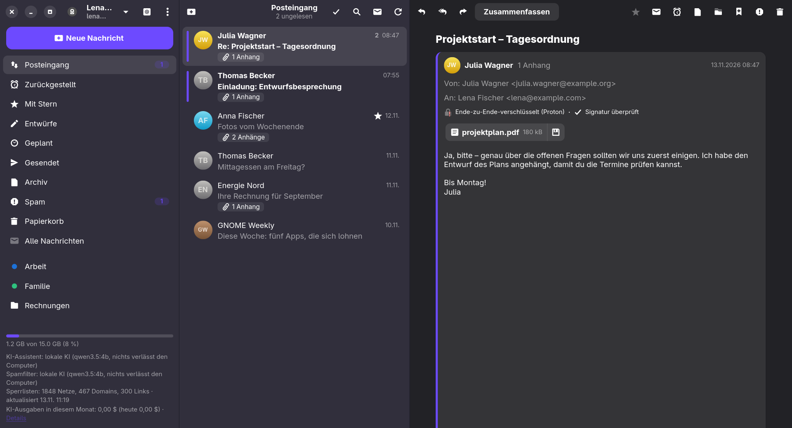
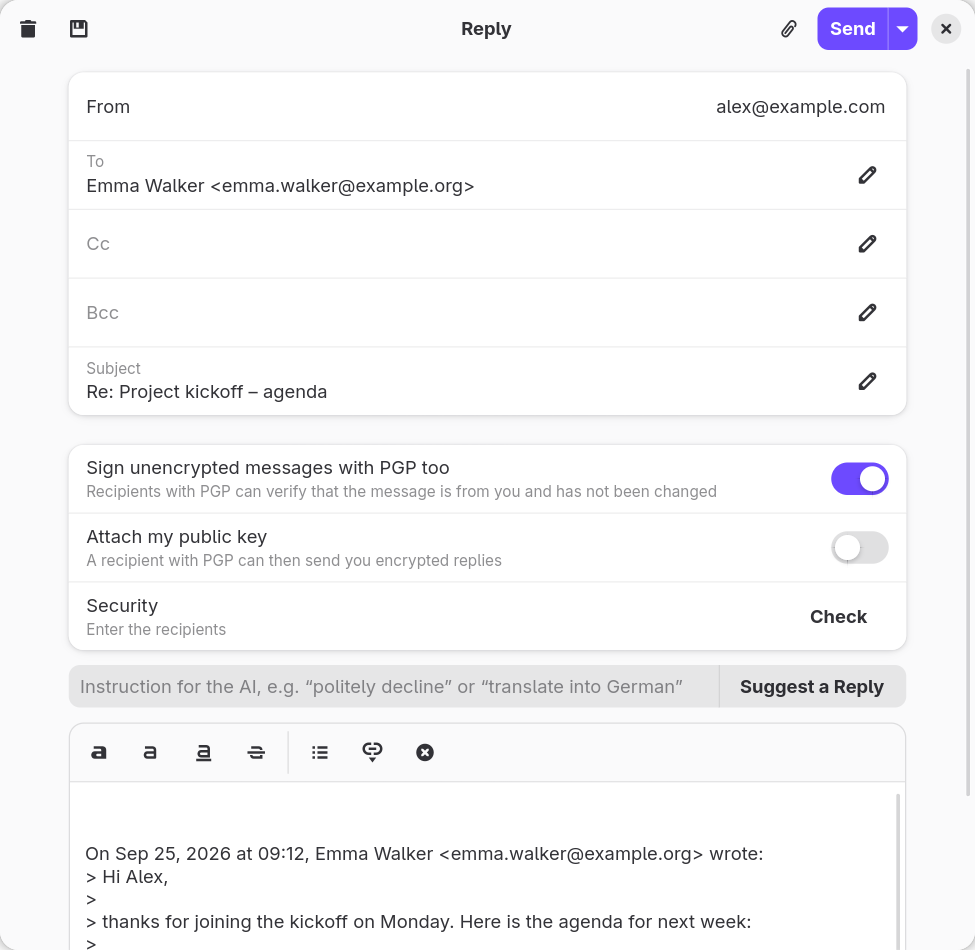
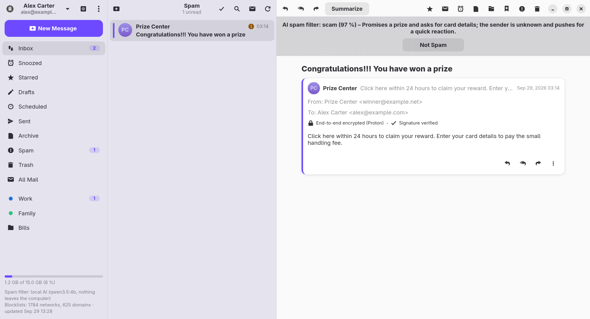
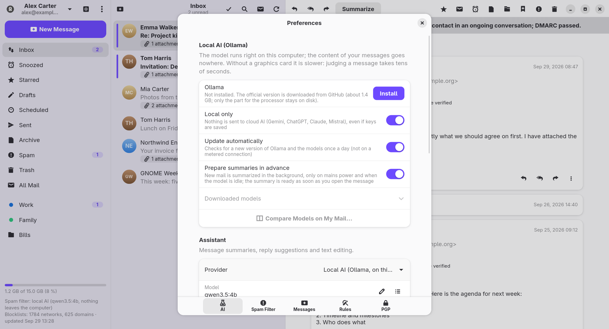
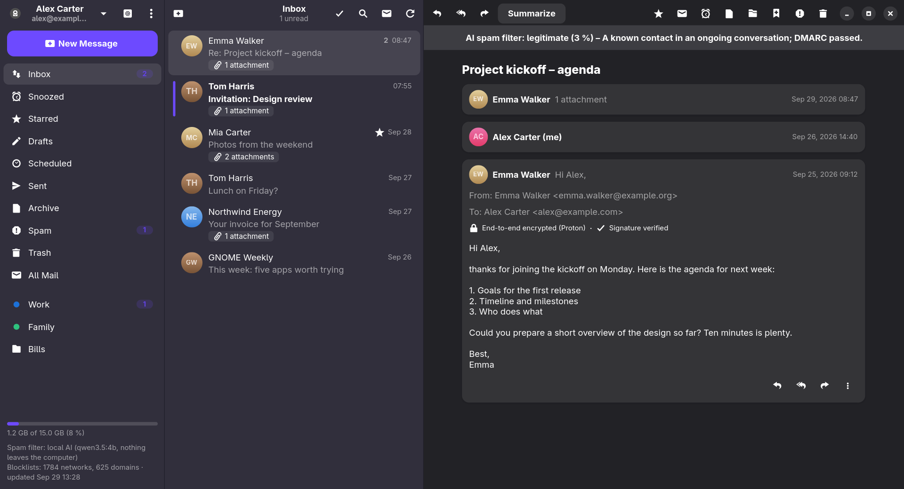

# Klient

**Ein E-Mail-Programm für GNOME mit eingebauter Unterstützung für Proton Mail, PGP und einem KI-Spamfilter.**

[English](README.md) · [Česky](README.cs.md) · [Dokumentation](docs/index.de.html) · [Versionen](https://github.com/Imbecile6197/klient/releases) · GPL-3.0



| | |
|---|---|
|  |  |
|  |  |

<sub>Bildschirmfotos des Demomodus – alle Personen und Nachrichten sind erfunden. Sie können ihn selbst ausprobieren: `KLIENT_DEMO=1 klient`.</sub>

Klient ist in Go mit GTK4 und libadwaita geschrieben. Es verbindet sich direkt mit Proton Mail (ohne Proton Bridge), mit Gmail, mit Seznam.cz und mit jedem IMAP/SMTP-Postfach. Jede neue Nachricht wird zuerst vom Spamfilter beurteilt; erst danach wird sie angezeigt und gemeldet. Die Oberfläche gibt es auf Englisch, Tschechisch und Deutsch.

## Funktionen

- **Proton Mail direkt** – unmittelbar über die Proton-API (SRP-Anmeldung, Zwei-Faktor-Authentifizierung, Zwei-Passwort-Modus).
- **Gmail, Seznam.cz und jedes IMAP/SMTP-Postfach** – die Server werden automatisch gefunden; neue E-Mails kommen über IMAP IDLE sofort an.
- **Verschlüsselung** – die Ende-zu-Ende-Verschlüsselung von Proton und PGP/MIME für die übrigen Dienste. Die Schlüssel der Empfänger werden über Web Key Directory, Autocrypt, importierte Schlüssel und optional keys.openpgp.org gefunden. Nachrichten an Empfänger ohne Schlüssel lassen sich signieren, und bevor sie unverschlüsselt gesendet werden, erscheint eine Warnung.
- **KI-Spamfilter** – die KI entscheidet anhand der Ergebnisse von SPF/DKIM/DMARC, der Markierungen von Proton, Treffern in Sperrlisten (Spamhaus DROP, URLhaus, OpenPhish – alle 12 Stunden aktualisiert) und Ihrer Listen erlaubter und blockierter Absender.
- **KI-Assistent** – Zusammenfassungen, Antwortvorschläge, Bearbeiten und Übersetzen von Entwürfen, „Ihre E-Mails fragen“, Einsortieren in Labels und eine Morgenübersicht. Anbieter: **Claude**, **ChatGPT**, **Gemini**, **Mistral** (EU-Server) oder ein **lokales Modell** über ein verwaltetes Ollama, sodass nichts Ihren Computer verlässt. Der Modus „Nur lokal“ sperrt alle Cloud-Anbieter.
- **E-Mail im Alltag** – Unterhaltungen, sichere HTML-E-Mails mit blockierten externen Inhalten, ein Editor für formatierten Text, Anhänge bis 25 MB, Entwürfe, Signatur als reiner Text oder HTML, Sendeverzögerung mit „Rückgängig“, geplantes Senden, Zurückstellen, Regeln, Labels und Ordner, Ziehen und Ablegen, Kalendereinladungen, automatische Antworten (Proton), Abmelden mit einem Klick, Drucken und Export als .eml.
- **Synchronisierung zwischen Computern** über das Proton-Konto – Spam-Urteile, Absenderlisten, Regeln, Signaturen und KI-Einstellungen teilen sich alle Ihre Computer; nur einer von ihnen erledigt die KI-Arbeit.
- **Mehrere Konten** in einem Fenster mit **allen Konten zusammen** in einer Liste, ein **Postausgang**, der nicht gesendete E-Mails aufbewahrt, Ordnerverwaltung, **Betrieb im Hintergrund** mit einem Symbol in der oberen Leiste, ein **verschlüsselter Offline-Cache**, **automatische Aktualisierungen** aus den GitHub-Versionen und eine eingebaute **Hilfe** (F1).

## Installation

Installieren Sie die neueste Version direkt von GitHub.

**Fedora** (44 und neuer):

```bash
sudo dnf install https://github.com/Imbecile6197/klient/releases/latest/download/klient.x86_64.rpm
```

**Ubuntu** (26.04 LTS und neuer) und andere Distributionen mit GNOME 50:

```bash
wget https://github.com/Imbecile6197/klient/releases/latest/download/klient_amd64.deb
sudo apt install ./klient_amd64.deb
```

Debian 13 ist für Klient zu alt (es braucht GLib 2.86 und libadwaita 1.6).

Danach sucht Klient einmal täglich nach neuen Versionen, lädt sie im Hintergrund herunter, überprüft ihre SHA-256-Prüfsumme und installiert sie nach einem Klick und dem Administratorpasswort. Ein Fenster „Neuerungen“ zeigt die Änderungen vor und nach jeder Aktualisierung.

Für das Symbol in der oberen Leiste braucht GNOME die Erweiterung AppIndicator (`gnome-shell-extension-appindicator`).

## Aus dem Quellcode bauen

```bash
sudo dnf install golang gcc gtk4-devel libadwaita-devel gobject-introspection-devel webkitgtk6.0-devel
make build        # der erste Build dauert eine Weile (CGo-Bindungen von GTK)
make run
make install      # nach ~/.local, samt .desktop-Datei und Symbol
make rpm          # ein Fedora-Paket in build/rpm/RPMS/x86_64/
packaging/deb.sh 0.7.3   # ein Ubuntu-Paket in build/deb/, gebaut in einem podman-Container
packaging/arch.sh 0.7.3  # ein Arch/Manjaro-Paket in build/arch/, gebaut in einem podman-Container
packaging/flatpak.sh 0.7.3  # ein Flatpak, offline gebaut und mit --user installiert
```

Die Builds für Arch und Flatpak werden von der Community gepflegt und vom Autor nicht getestet; offizielle Pakete sind nur RPM und deb in den Versionen. Probleme damit melden Sie bitte in den Issues.

Das Arch-Paket braucht GLib ≥ 2.89.3 (für die GTK-Bindungen), die derzeit in Archs `core-testing`/`extra-testing` liegt; `packaging/arch/Containerfile` aktiviert diese. Manjaro stable hinkt Arch hinterher und hat daher möglicherweise noch keine ausreichend neue GLib, um das Paket zu installieren.

Das Flatpak umgeht das: Es läuft mit der eigenen GLib, GTK 4, libadwaita und WebKitGTK der GNOME-Laufzeitumgebung und funktioniert daher auch dort, wo die Systembibliotheken für das native Paket zu alt sind (zum Beispiel Manjaro mit GLib 2.88). Es braucht `flatpak` und `flatpak-builder`; `packaging/flatpak.sh` installiert Laufzeitumgebung und SDK, legt die Go-Module in einen sauberen Export des Checkouts und baut dann in der Sandbox von flatpak-builder ohne Netz (`-mod=vendor`, `GOPROXY=off`). Mit `--bundle` wird zusätzlich `build/flatpak/klient.flatpak` exportiert. Das Manifest ist `packaging/flatpak/eu.libormacak.Klient.yml`.

Die GTK-Bindungen brauchen GLib ≥ 2.89.3 und WebKitGTK 6.0; die stabile Laufzeitumgebung **GNOME 51** bietet beides (GLib 2.90.1, WebKitGTK 2.54, libadwaita 1.10) und ist daher das Ziel. Frühere Laufzeitumgebungen waren zu alt (GNOME 49 hatte GLib 2.86.5, GNOME 50 hatte 2.88.1). Die Go-Toolchain kommt von go.dev (per sha256 festgelegt) statt aus der SDK-Erweiterung, was den Build offline und unabhängig von der Basis der Laufzeitumgebung hält. Für eine Einreichung bei Flathub ersetzen Sie die Quelle `dir` durch eine getaggte `git`/`archive`-Quelle, deren Baum `vendor/` enthält, und schalten den eingebauten GitHub-Updater von Klient aus (Flatpak übernimmt die Aktualisierungen, und Apps, die sich selbst aktualisieren, werden nicht angenommen).

Das Bundle `klient.flatpak` auf einem anderen Computer installieren: Ein Bundle enthält nur die App, nicht ihre Laufzeitumgebung, daher muss dort zuerst die Laufzeitumgebung GNOME 51 installiert werden (von Flathub).

```bash
flatpak remote-add --user --if-not-exists flathub https://dl.flathub.org/repo/flathub.flatpakrepo
flatpak install --user flathub org.gnome.Platform//51   # einmalig
flatpak install --user ./klient.flatpak
flatpak run eu.libormacak.Klient
```

Eine Version veröffentlichen (braucht `gh` und einen committeten Baum): Schreiben Sie die Hinweise nach `packaging/release-notes/X.Y.Z.md` (Abschnitte „## English“, „## Česky“ und „## Deutsch“ – Klient zeigt sie unter „Neuerungen“ an, und sie werden auf GitHub veröffentlicht), dann `git tag -a vX.Y.Z -m "Klient X.Y.Z" && make release VERSION=X.Y.Z`.

## Erster Start

1. Melden Sie sich mit Ihrem Proton-Konto an, oder wählen Sie **Anderer Dienst** für Gmail, Seznam.cz oder ein anderes IMAP-Postfach. Gmail und Seznam mit Zwei-Faktor-Authentifizierung brauchen ein App-Passwort; das Anmeldefenster verlinkt die richtige Seite.
2. Wählen Sie in **Einstellungen → KI** einen Anbieter für den Assistenten und für den Spamfilter und fügen Sie seinen API-Schlüssel ein – oder installieren Sie die lokale KI und lassen Sie sie auf Ihrem Computer laufen.
3. Führen Sie optional **Posteingang mit KI prüfen** aus dem Menü aus, um Ihre letzten 50 Nachrichten zu filtern.

Die vollständige Benutzerdokumentation finden Sie in [`docs/index.de.html`](docs/index.de.html) (Englisch: [`docs/index.html`](docs/index.html), Tschechisch: [`docs/index.cs.html`](docs/index.cs.html)); in der Anwendung drücken Sie F1.

## Übersetzungen

Die Texte im Code sind englisch und werden über gettext-Kataloge in [`po/`](po/) übersetzt, die in das Programm eingebettet sind. Die Sprache richtet sich nach dem System (`LC_ALL`, `LC_MESSAGES`, `LANG`) und lässt sich in Einstellungen → Allgemein ändern. Um eine Sprache hinzuzufügen, kopieren Sie `po/de.po` nach `po/<code>.po`, übersetzen sie, tragen die Sprache in `internal/i18n` ein (ihren Namen und ihre Pluralregel) und führen `go test ./internal/i18n` aus – der Test prüft, dass jeder Text im Code mit denselben Formatangaben übersetzt ist.

## Projektstruktur

| Paket | Zweck |
|---|---|
| `internal/protonmail` | Proton-Anmeldung, Entsperren der Schlüssel, Auflisten und Entschlüsseln von Nachrichten, Anhänge, verschlüsseltes Senden, der Ereignisstrom |
| `internal/imapmail` | IMAP/SMTP-Konten: Servererkennung, IDLE, Unterhaltungen, lokales Zurückstellen und Planen, Gmail-Labels, PGP/MIME |
| `internal/mailbox` | Die gemeinsame Kontoschnittstelle über Proton und IMAP |
| `internal/pgp`, `internal/pgpmime` | Schlüssel der Kontakte und eigene Schlüssel, Signaturprüfungen, PGP/MIME, WKD und Autocrypt |
| `internal/ai` | Claude, OpenAI, Gemini, Mistral und Ollama hinter einer Schnittstelle: Spam-Klassifizierung mit JSON-Schema, Zusammenfassungen, Antworten |
| `internal/ollama` | Das verwaltete lokale Ollama: Download, Prüfsumme, Aktualisierungen, Start bei Bedarf |
| `internal/spam` | Sperrlisten und ihre Aktualisierung, der Spamfilter (Anhaltspunkte → KI → Entscheidung), erlaubte und blockierte Absender |
| `internal/i18n`, `po` | Übersetzungen |
| `internal/update` | Aktualisierungen aus den GitHub-Versionen |
| `internal/ui` | Die GNOME-Oberfläche |
| `docs` | Benutzerdokumentation, auch als Hilfe angezeigt |

Dateien: Einstellungen in `~/.config/klient/config.json`, Daten (Sperrlisten, Entscheidungen des Filters, Schlüssel, Cache, Ollama) in `~/.local/share/klient/`, Geheimnisse im Schlüsselbund des Systems (Secret Service, siehe unten).

## Passwortverwaltung (KWallet, KeePassXC, GNOME Keyring)

Klient speichert Passwörter, API-Schlüssel und Proton-Sitzungen über die freedesktop-Schnittstelle **Secret Service**, spricht also mit dem Programm, das auf dem D-Bus-Sitzungsbus den Namen `org.freedesktop.secrets` besitzt. Unter GNOME ist das meist GNOME Keyring oder oo7. KeePassXC funktioniert nachweislich unter Manjaro mit KDE. KWallet kann dieselbe Schnittstelle anbieten, ist mit Klient aber nicht bestätigt: Auf dem genannten Manjaro-System hat es den Namen nicht registriert. Den Namen kann immer nur ein Anbieter besitzen.

Beim Wechsel des Anbieters wird nichts übertragen: Sie müssen sich erneut anmelden und Ihre API-Schlüssel erneut eingeben, und Klient erstellt einen neuen Schlüssel für den Offline-Cache, sodass der alte Cache nicht mehr gelesen werden kann.

Prüfen, welcher Dienst registriert ist:

```bash
# wer den Namen gerade besitzt (ein Fehler bedeutet: niemand)
gdbus call --session --dest org.freedesktop.DBus --object-path /org/freedesktop/DBus \
  --method org.freedesktop.DBus.GetNameOwner org.freedesktop.secrets

# oder mit systemd: zeigt den besitzenden Prozess (PID, Befehl)
busctl --user status org.freedesktop.secrets

# Anbieter, die bei Bedarf gestartet werden können
busctl --user list --activatable | grep -i secrets
```

Optional können Sie zum Beispiel KeePassXC als Anbieter registrieren:

1. Beenden Sie den aktuellen Anbieter (zum Beispiel `gnome-keyring-daemon` oder `oo7-daemon`), sonst behält er den Namen. Ein Anbieter, der bei Bedarf startet, kann sich den Namen zurückholen, fahren Sie daher sofort mit dem nächsten Schritt fort.
2. Öffnen Sie in KeePassXC **Werkzeuge → Einstellungen → Secret-Service-Integration** und aktivieren Sie die Integration des freedesktop.org Secret Service.
3. Öffnen Sie Ihre Datenbank, gehen Sie zu **Datenbank → Datenbankeinstellungen → Secret-Service-Integration**, lassen Sie die Einträge einer Gruppe freigeben und wählen Sie die Gruppe (zum Beispiel `Klient`).
4. Lassen Sie die Datenbank entsperrt, führen Sie die Prüfung oben aus und starten Sie dann Klient. Als Besitzer sollte jetzt KeePassXC erscheinen, und die Einträge von Klient landen in der gewählten Gruppe.

## Datenschutz und Einschränkungen

- **Bei einem Cloud-KI-Anbieter wird ihm der Inhalt der verarbeiteten Nachrichten gesendet** (Spamfilter, Zusammenfassungen, Vorschläge). Der Spamfilter sendet höchstens die ersten 6.000 Zeichen des Textes. Anfragen an OpenAI verwenden `store: false`. Mit lokaler KI oder im Modus „Nur lokal“ verlässt nichts Ihren Computer.
- Die Proton-API ist für Clients von Drittanbietern nicht offiziell dokumentiert und kann sich ändern. Proton kann eine Anmeldung ablehnen oder ein CAPTCHA verlangen; meist hilft es, sich einmal aus demselben Netz im Web anzumelden. Die App weist sich mit dem Header `x-pm-appversion` aus (`proton_app_version` in der Konfiguration, standardmäßig `Other`).
- Bei Proton durchsucht die Suche Betreff, Absender und Empfänger, nicht den Nachrichtentext (die Texte sind auf dem Server Ende-zu-Ende-verschlüsselt).
- Bei IMAP-Diensten funktionieren Zurückstellen und geplantes Senden nur, solange Klient läuft (im Hintergrund genügt).
- Outlook / Hotmail wird nicht unterstützt.
- `third_party/go-proton-api` ist eine Kopie der Bibliothek von Proton mit einigen Ergänzungen (Felder der Unterhaltungen, geplantes Senden, Zurückstellen, automatische Antworten); `third_party/gotk4-webkitgtk` ist eine Auswahl der Go-Bindungen für WebKitGTK. Siehe jeweils `KLIENT_PATCHES.md`.

## Lizenz

Fehlerberichte und Ideen sind in den [Issues](https://github.com/Imbecile6197/klient/issues) willkommen.

Lizenziert unter der [GNU General Public License v3.0](LICENSE).
