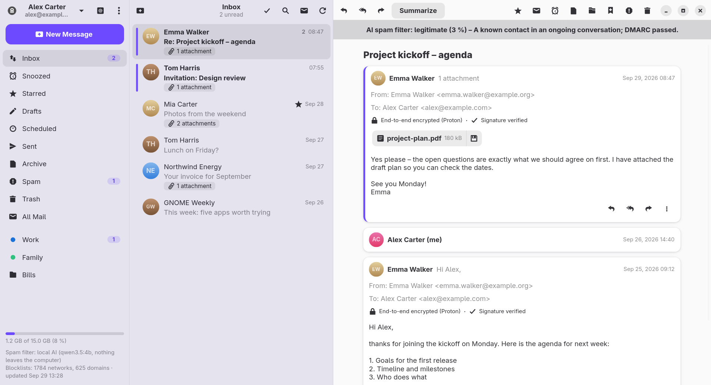
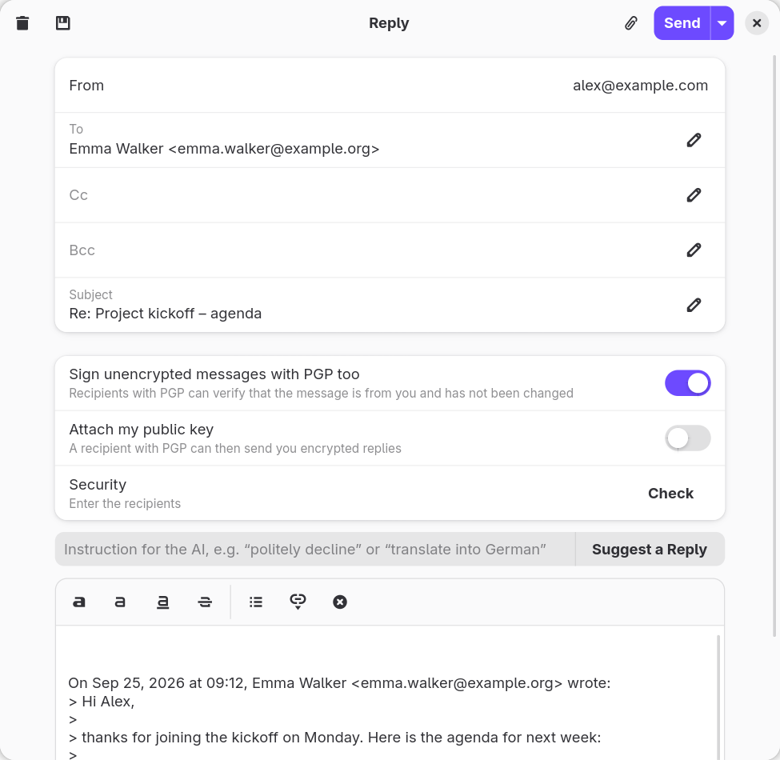
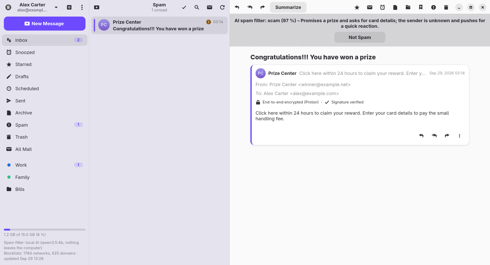
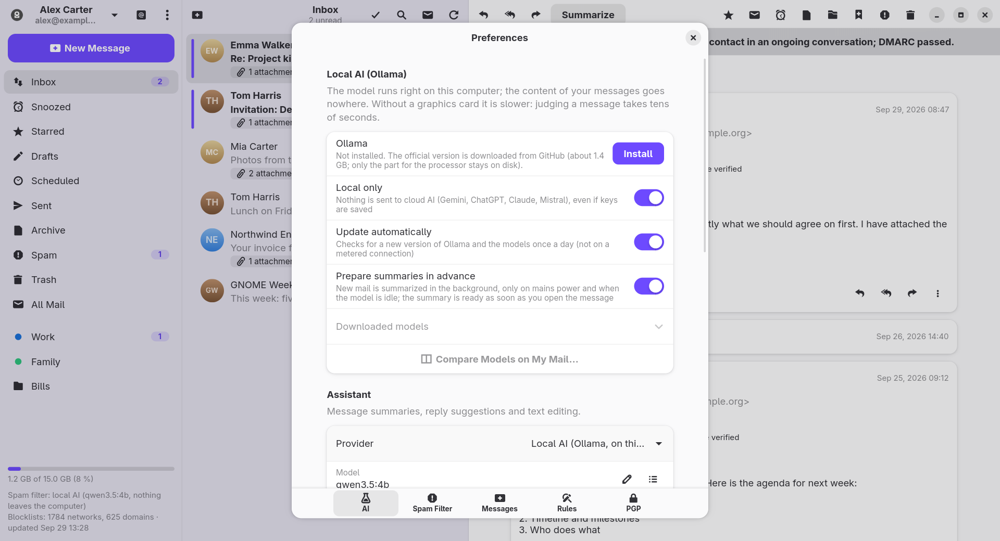
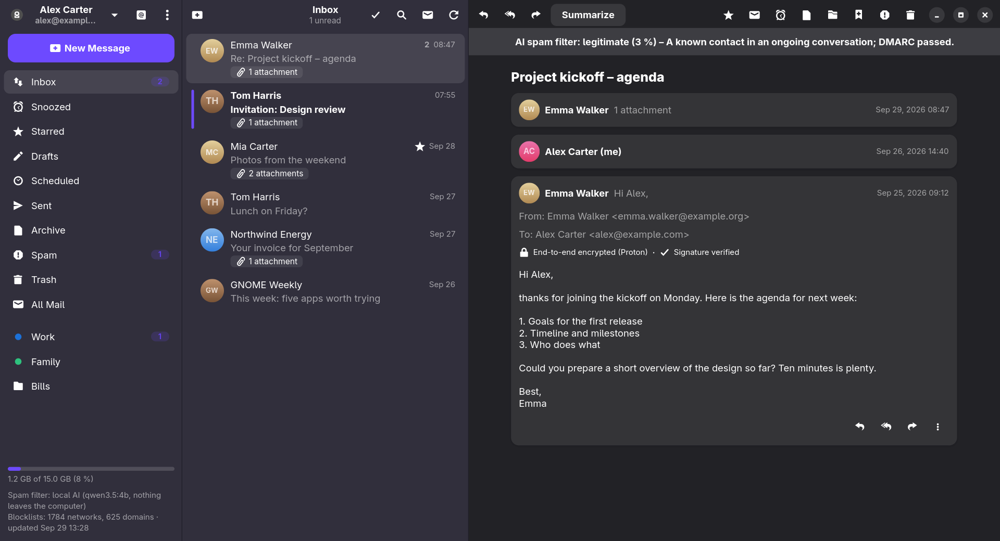

# Klient

**A mail client for GNOME with native Proton Mail support, PGP and an AI spam filter.**

[Česky](README.cs.md) · [Documentation](docs/index.html) · [Releases](https://github.com/Imbecile6197/klient/releases) · GPL-3.0



| | |
|---|---|
|  |  |
|  |  |

<sub>Screenshots of the demo mode – all people and messages are made up. You can try it yourself: `KLIENT_DEMO=1 klient`.</sub>

Klient is written in Go with GTK4 and libadwaita. It connects directly to Proton Mail (no Proton Bridge needed), to Gmail, to Seznam.cz and to any IMAP/SMTP mailbox. Every new message is judged by the spam filter first; only then is it shown and announced. The interface is available in English and Czech.

## Features

- **Proton Mail natively** – straight over the Proton API (SRP login, two-factor authentication, two-password mode).
- **Gmail, Seznam.cz and any IMAP/SMTP mailbox** – the servers are found automatically; new mail arrives instantly over IMAP IDLE.
- **Encryption** – Proton's end-to-end encryption, and PGP/MIME for the other services. Recipients' keys are found through Web Key Directory, Autocrypt, imported keys and optionally keys.openpgp.org. Messages to recipients without a key can be signed, and a warning is shown before they are sent unencrypted.
- **AI spam filter** – the AI decides using SPF/DKIM/DMARC results, Proton's markers, blocklist hits (Spamhaus DROP, URLhaus, OpenPhish – refreshed every 12 hours) and your lists of allowed and blocked senders.
- **AI assistant** – summaries, reply suggestions, editing and translating drafts, “Ask Your Mail”, sorting into labels and a morning overview. Providers: **Claude**, **ChatGPT**, **Gemini**, **Mistral** (EU servers) or a **local model** through a managed Ollama, so nothing leaves your computer. A “Local only” mode blocks every cloud provider.
- **Everyday mail** – threads, safe HTML mail with remote content blocked, a rich-text editor, attachments up to 25 MB, drafts, plain-text or HTML signature, send delay with Undo, scheduled sending, snoozing, rules, labels and folders, drag and drop, calendar invitations, automatic replies (Proton), one-click unsubscribe, printing and .eml export.
- **Sync between computers** through the Proton account – spam verdicts, sender lists, rules, signatures and AI settings are shared by all your computers; only one of them does the AI work.
- **Multiple accounts** in one window with **all accounts together** in one list, an **Outbox** that keeps unsent mail, folder management, **background mode** with a tray icon, an **encrypted offline cache**, **automatic updates** from GitHub releases and built-in **help** (F1).

## Installation

Install the latest release straight from GitHub.

**Fedora** (44 and newer):

```bash
sudo dnf install https://github.com/Imbecile6197/klient/releases/latest/download/klient.x86_64.rpm
```

**Ubuntu** (26.04 LTS and newer) and other distributions with GNOME 50:

```bash
wget https://github.com/Imbecile6197/klient/releases/latest/download/klient_amd64.deb
sudo apt install ./klient_amd64.deb
```

Debian 13 is too old for Klient (it needs GLib 2.86 and libadwaita 1.6).

After that, Klient checks for new releases once a day, downloads them in the background, verifies their SHA-256 checksum and installs them after one click and the administrator password. A What's New window shows the changes before and after each update.

For the tray icon, GNOME needs the AppIndicator extension (`gnome-shell-extension-appindicator`).

## Building from source

```bash
sudo dnf install golang gcc gtk4-devel libadwaita-devel gobject-introspection-devel webkitgtk6.0-devel
make build        # the first build takes a while (CGo bindings of GTK)
make run
make install      # into ~/.local, including the .desktop file and the icon
make rpm          # a Fedora package in build/rpm/RPMS/x86_64/
packaging/deb.sh 0.7.3   # an Ubuntu package in build/deb/, built in a podman container
packaging/arch.sh 0.7.3  # an Arch/Manjaro package in build/arch/, built in a podman container
packaging/flatpak.sh 0.7.3  # a Flatpak, built offline and installed with --user
```

The Arch and Flatpak builds are community-maintained and untested by the author; the official packages are only the RPM and deb in the releases. Please report problems with them in Issues.

The Arch package needs GLib ≥ 2.89.3 (for the GTK bindings), which currently lives in Arch's `core-testing`/`extra-testing`; `packaging/arch/Containerfile` enables them. Manjaro stable lags Arch, so it may not have a new enough GLib to install the package yet.

The Flatpak sidesteps that: it runs against the GNOME runtime's own GLib, GTK 4, libadwaita and WebKitGTK, so it works even where the system libraries are too old for the native package (for example Manjaro with GLib 2.88). It needs `flatpak` and `flatpak-builder`; `packaging/flatpak.sh` installs the runtime and SDK, vendors the Go modules into a clean checkout, then builds in flatpak-builder's sandbox with no network (`-mod=vendor`, `GOPROXY=off`). Pass `--bundle` to also export `build/flatpak/klient.flatpak`. The manifest is `packaging/flatpak/eu.libormacak.Klient.yml`.

The GTK bindings need GLib ≥ 2.89.3 and WebKitGTK 6.0; the stable **GNOME 51** runtime provides them (GLib 2.90.1, WebKitGTK 2.54, libadwaita 1.10), so that is the target. Earlier runtimes were too old (GNOME 49 had GLib 2.86.5, GNOME 50 had 2.88.1). The Go toolchain is bundled from go.dev (pinned by sha256) rather than the SDK extension, which keeps the build offline and independent of the runtime base. For a Flathub submission, replace the `dir` source with a tagged `git`/`archive` source whose tree contains `vendor/`, and disable Klient's built-in GitHub updater (Flatpak handles updates, and self-updating apps are not accepted).

Installing the `klient.flatpak` bundle on another computer: a bundle contains only the app, not its runtime, so the GNOME 51 runtime has to be installed there first (from Flathub).

```bash
flatpak remote-add --user --if-not-exists flathub https://dl.flathub.org/repo/flathub.flatpakrepo
flatpak install --user flathub org.gnome.Platform//51   # once
flatpak install --user ./klient.flatpak
flatpak run eu.libormacak.Klient
```

Publishing a release (needs `gh` and a committed tree): write the notes to `packaging/release-notes/X.Y.Z.md` (an “## English” and a “## Česky” section – they are shown in Klient as What's New and published on GitHub), then `git tag -a vX.Y.Z -m "Klient X.Y.Z" && make release VERSION=X.Y.Z`.

## First start

1. Log in with your Proton account, or choose **Other Service** for Gmail, Seznam.cz or another IMAP mailbox. Gmail and Seznam with two-factor authentication need an app password; the login window links to the right page.
2. In **Preferences → AI**, choose a provider for the assistant and for the spam filter and paste its API key – or install the local AI and let it run on your computer.
3. Optionally run **Check the Inbox with AI** from the menu to filter your latest 50 messages.

The complete user documentation is in [`docs/index.html`](docs/index.html) (Czech: [`docs/index.cs.html`](docs/index.cs.html)); in the application, press F1.

## Translations

The strings in the code are English and are translated through gettext catalogs in [`po/`](po/), which are embedded into the binary. The language follows the system (`LC_ALL`, `LC_MESSAGES`, `LANG`) and can be changed in Preferences → General. To add a language, copy `po/cs.po` to `po/<code>.po`, translate it, add the language to `internal/i18n` (its name and plural rule) and run `go test ./internal/i18n` – the test checks that every string in the code is translated with the same format verbs.

## Project structure

| Package | Purpose |
|---|---|
| `internal/protonmail` | Proton login, key unlocking, listing and decrypting messages, attachments, encrypted sending, the event stream |
| `internal/imapmail` | IMAP/SMTP accounts: server discovery, IDLE, threads, local snooze and scheduling, Gmail labels, PGP/MIME |
| `internal/mailbox` | The common account interface over Proton and IMAP |
| `internal/pgp`, `internal/pgpmime` | Keys of contacts and your own keys, signature checks, PGP/MIME, WKD and Autocrypt |
| `internal/ai` | Claude, OpenAI, Gemini, Mistral and Ollama behind one interface: spam classification with a JSON schema, summaries, replies |
| `internal/ollama` | The managed local Ollama: download, checksum, updates, start on demand |
| `internal/spam` | Blocklists and their updates, the spam filter (evidence → AI → decision), allowed and blocked senders |
| `internal/i18n`, `po` | Translations |
| `internal/update` | Updates from GitHub releases |
| `internal/ui` | The GNOME interface |
| `docs` | User documentation, also shown as Help |

Files: settings in `~/.config/klient/config.json`, data (blocklists, filter decisions, keys, cache, Ollama) in `~/.local/share/klient/`, secrets in the system keyring (Secret Service, see below).

## Secret manager (KWallet, KeePassXC, GNOME Keyring)

Klient stores passwords, API keys and Proton sessions through the freedesktop **Secret Service** API, i.e. it talks to whichever program owns the `org.freedesktop.secrets` name on the D-Bus session bus. On GNOME that is usually GNOME Keyring or oo7. KeePassXC is confirmed to work on Manjaro with KDE. KWallet can offer the same interface, but it is not confirmed with Klient: on that Manjaro system it did not register the name. Only one provider can own the name at a time.

Changing the provider does not move anything across: you have to sign in again and enter your API keys again, and Klient creates a new key for the offline cache, so the old cache can no longer be read.

Check which service is registered:

```bash
# who owns the name right now (an error means nobody does)
gdbus call --session --dest org.freedesktop.DBus --object-path /org/freedesktop/DBus \
  --method org.freedesktop.DBus.GetNameOwner org.freedesktop.secrets

# or, with systemd: shows the owning process (PID, command)
busctl --user status org.freedesktop.secrets

# providers that can be started on demand
busctl --user list --activatable | grep -i secrets
```

Optionally you can register, for example, KeePassXC as the provider:

1. Quit the current provider (for example `gnome-keyring-daemon` or `oo7-daemon`), or it keeps the name. A provider that starts on demand can take the name back, so go on to the next step straight away.
2. In KeePassXC open **Tools → Settings → Secret Service Integration** and tick **Enable KeePassXC Freedesktop.org Secret Service integration**.
3. Open your database, go to **Database → Database Settings → Secret Service Integration**, tick **Expose entries under this group** and choose a group (for example `Klient`).
4. Keep the database unlocked, run the check above, then start Klient. It should now report KeePassXC as the owner and Klient's entries appear in the chosen group.

## Privacy and limitations

- **With a cloud AI provider, the content of the processed messages is sent to that provider** (spam filter, summaries, suggestions). The spam filter sends at most the first 6,000 characters of the body. Requests to OpenAI use `store: false`. With local AI or in “Local only” mode, nothing leaves your computer.
- The Proton API is not officially documented for third-party clients and may change. Proton may reject a login or ask for a CAPTCHA; logging in once on the web from the same network usually helps. The app identifies itself with the `x-pm-appversion` header (`proton_app_version` in the config, `Other` by default).
- On Proton, search covers the subject, sender and recipients, not the message text (bodies are end-to-end encrypted on the server).
- With IMAP services, snoozing and scheduled sending work only while Klient is running (the background is enough).
- Outlook / Hotmail is not supported.
- `third_party/go-proton-api` is a copy of Proton's library with a few additions (conversation fields, scheduled sending, snoozing, automatic replies); `third_party/gotk4-webkitgtk` is a selection of the WebKitGTK Go bindings. See `KLIENT_PATCHES.md` in each.

## License

Bug reports and ideas are welcome in [Issues](https://github.com/Imbecile6197/klient/issues).

Licensed under the [GNU General Public License v3.0](LICENSE).
